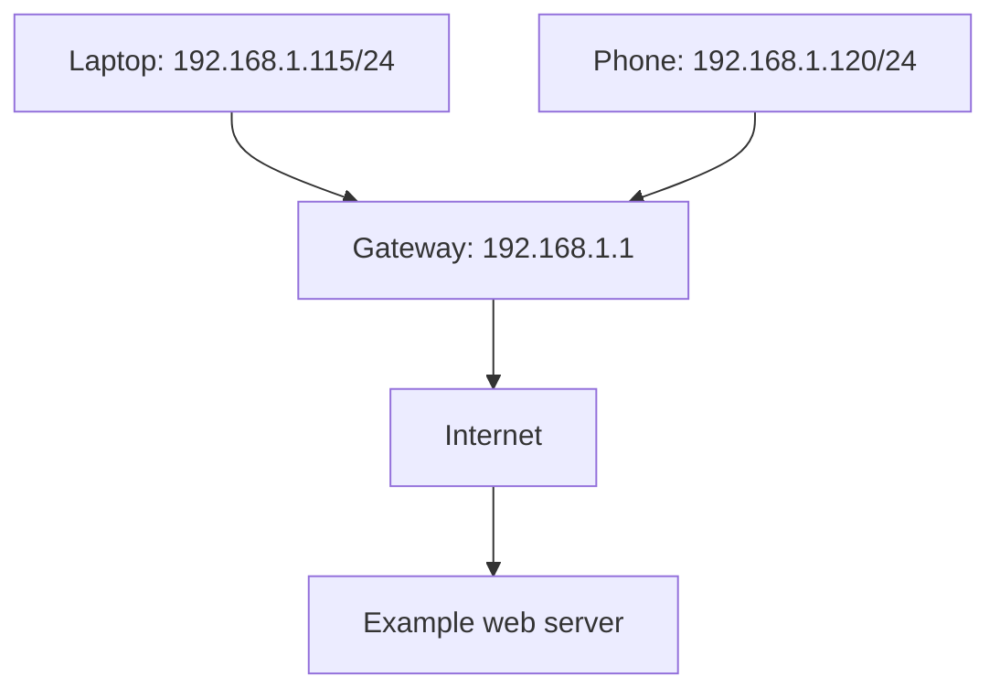

# IP Addressing and Network Security Basics

## Purpose

Understand IP addressing, subnetting, gateways, proxies, and VPNs through simple examples and network observations.

## Key Concepts

- An IP address identifies a network interface.
- A subnet mask separates the network portion from the host portion.
- Devices in the same subnet can communicate locally if network rules allow it.
- Traffic to a remote network uses a matching route, often through the default gateway.
- Private IPv4 addresses are not directly routable on the public Internet.
- Home routers commonly use NAT with port translation to let multiple devices share one public IPv4 address.

## IP Addressing Examples

### Home Network

| Item | Value |
|---|---|
| Network | `192.168.1.0/24` |
| Laptop | `192.168.1.115` |
| Phone | `192.168.1.120` |
| Gateway | `192.168.1.1` |
| Subnet mask | `255.255.255.0` |

The laptop and phone are in the same subnet. They can communicate locally without a router forwarding traffic between networks.

Traffic to the Internet normally goes through the default gateway at `192.168.1.1`.

### Office Network

| Item | Value |
|---|---|
| Network | `10.10.20.0/24` |
| Workstation | `10.10.20.25` |
| Server | `10.10.20.50` |
| Gateway | `10.10.20.1` |
| Subnet mask | `255.255.255.0` |

The workstation and server belong to the same subnet.

On an Ethernet network, the workstation uses ARP to find the server's MAC address if the mapping is not already cached.

For a remote destination reached through the gateway, it uses the gateway's MAC address instead.

### Communication Between Networks

| Device | IP address | Network |
|---|---|---|
| Client | `192.168.10.25/24` |
`192.168.10.0/24` |
| Web server | `203.0.113.10/24` |
`203.0.113.0/24` |
| Client gateway | `192.168.10.1/24` |
`192.168.10.0/24` |

The client and web server are in different networks. The client sends the packet to its gateway, and routers forward it towards the destination.

`203.0.113.0/24` is reserved for documentation. It represents an example destination, not a real public service.

## Example Network Diagram



## Subnetting and CIDR

Subnetting divides a larger network into smaller networks.

CIDR notation uses a slash followed by the number of bits assigned to the network portion. An IPv4 address contains 32 bits.

| Prefix | Network bits | Host bits | Subnet mask |
|---|---|---|---|
| `/24` | 24 | 8 | `255.255.255.0` |
| `/16` | 16 | 16 | `255.255.0.0` |

A larger prefix number leaves fewer bits for host addresses and creates a smaller address range.

### Same Subnet Example

These devices belong to the same subnet:

- `192.168.10.25/24`
- `192.168.10.80/24`

Their network is `192.168.10.0/24`.

For this subnet:

| Address type | Value |
|---|---|
| Network address | `192.168.10.0` |
| Usable host range | `192.168.10.1–192.168.10.254` |
| Broadcast address | `192.168.10.255` |

`192.168.20.25/24` belongs to a different subnet. Communication between these subnets requires routing.

Subnetting separates address ranges. Firewall or access control rules are needed to restrict traffic between them.

## Proxy Servers

A proxy handles requests on behalf of another system.

| Type | Purpose | Example |
|---|---|---|
| Forward proxy | Handles requests on behalf of clients. | Filters employees' access to external websites. |
| Reverse proxy | Handles incoming requests on behalf of servers. | Sends visitors' requests to the appropriate web server. |

A proxy and NAT are different mechanisms. A proxy handles communication as an intermediary; NAT translates network addresses.

## VPNs and Privacy

A VPN creates a protected tunnel between its endpoints over another network, such as the Internet.

| VPN type | Connects | Example |
|---|---|---|
| Remote access | An individual device to a network. | An employee connects to company resources from home. |
| Site-to-site | One network to another network. | Two company offices share internal resources. |

Access rules still determine which resources users can reach.

A VPN does not guarantee anonymity. Websites can still identify users through accounts, cookies, and other information.

### VPN Protocols

| Protocol | Main characteristics |
|---|---|
| WireGuard | A VPN protocol with a simple design and configuration. |
| IPsec | A set of protocols used to protect IP traffic, including VPN connections. |

Both can support remote access and site-to-site connections. The choice depends on compatibility, configuration, and network requirements.

## macOS Network Commands

### Show the Local IPv4 Address

```bash
ipconfig getifaddr en0
```

Example output:

```text
192.168.1.115
```

The interface name may differ between devices.

### Show the Default Gateway

```bash
route -n get default
```

Relevant example output:

```text
gateway: 192.168.1.1
interface: en0
```

### Show DNS Configuration

```bash
scutil --dns
```

This displays the system's configured DNS resolvers.

### Test Connectivity

```bash
ping -c 10 google.com
```

This sends ten ICMP Echo Requests and reports replies, round-trip times, and packet loss.

Replies are expected if the destination is reachable and ICMP is allowed.

### Display the Route to a Destination

```bash
traceroute google.com
```

This attempts to identify router hops towards the destination. Some routers may not respond to its probes.

### Show the ARP Table

```bash
arp -a
```

This displays cached IPv4-to-MAC address mappings on the local network.

## Practice and Observations

### Local Network Check

During my local test, I identified:

- A private IPv4 address in the `192.168.1.0/24` network.
- `192.168.1.1` as the default gateway.
- `en0` as the active network interface.
- Ten ping replies from ten requests, with `0%` packet loss.
- A traceroute that reached Google at approximately the tenth hop.

Some traceroute hops did not respond, but the destination was reached.

These checks helped me identify my network settings and observe communication with a remote destination. They did not directly test communication between two local devices.

### Subnetting, Proxy, and VPN Review

I reviewed:

1. `/24` and `/16` addressing examples.
2. Forward and reverse proxies.
3. Remote access and site-to-site VPNs.
4. WireGuard and IPsec.

These were study exercises. I did not configure separate subnets or deploy a proxy or VPN.

### Wireshark Lab

In the TryHackMe Networking Secure Protocols lab, I opened the provided capture:

```text
randy-chromium.pcapng
```

I applied this display filter:

```wireshark
http.request.method == "POST"
```

The filter returned no packets.

This result does not prove that no login request exists. The TLS key log configuration and the application protocol need further checking. HTTP/2 uses different display filter fields.

The password challenge is still in progress.

## What I Learned

- The IP address and subnet mask determine the local subnet.
- ARP resolves local IPv4 next-hop addresses to MAC addresses.
- Routers forward traffic between networks.
- CIDR specifies the length of the network portion.
- Proxies act as intermediaries for clients or servers.
- VPNs protect traffic between VPN endpoints.
- Wireshark filters must match the protocol being analysed.
- Missing ping or traceroute replies do not always mean a device is offline.

## Limitations

- Addresses and routes can change between networks.
- Example addresses and outputs are illustrative or sanitized.
- A successful ping does not prove that every service is available.
- ICMP filtering can affect ping and traceroute results.
- Subnetting alone does not enforce access restrictions.
- I have not deployed a proxy or VPN.
- The Wireshark challenge is not yet complete.

## Next Steps

- Review more `/24` and `/16` examples.
- Verify the TLS key log configuration in Wireshark.
- Inspect decrypted HTTP or HTTP/2 login traffic.
- Record the final lab result after verifying it.
