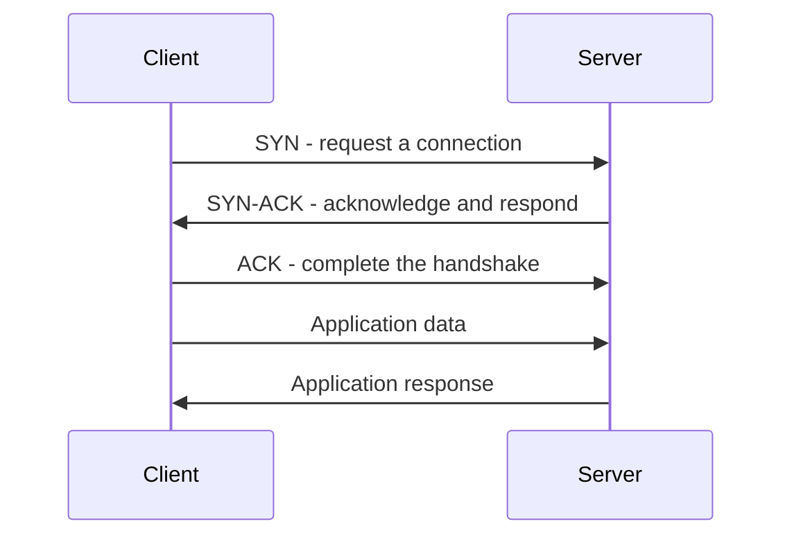
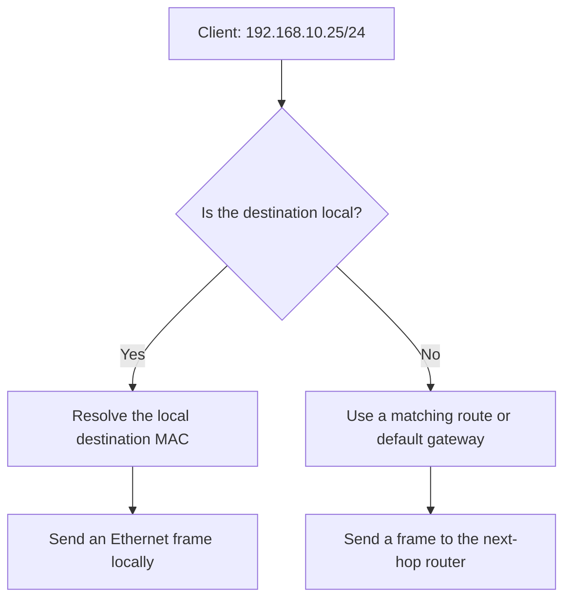
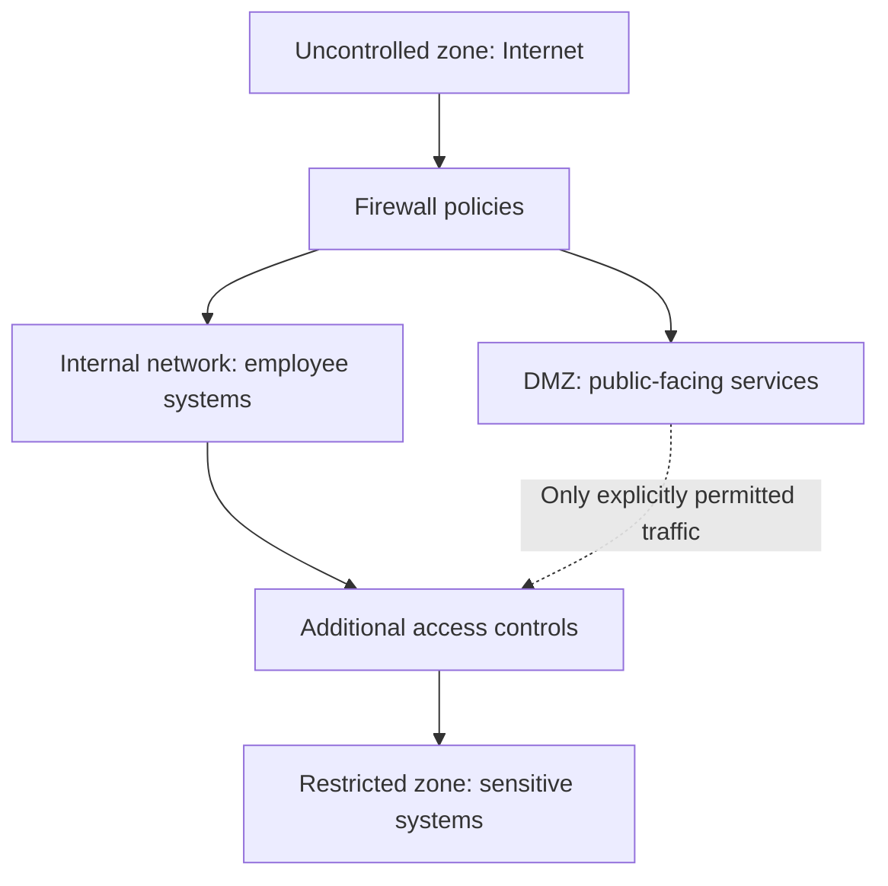
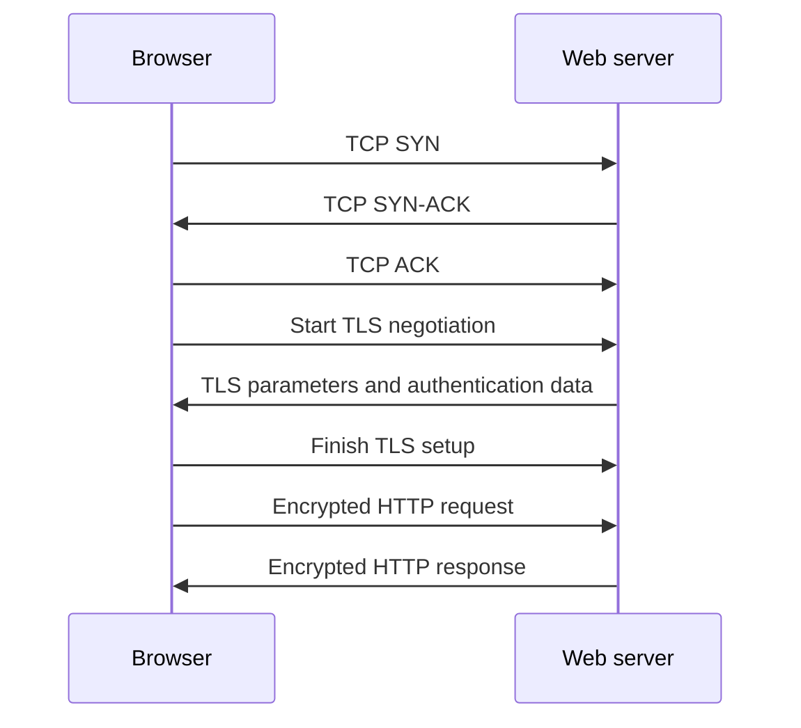
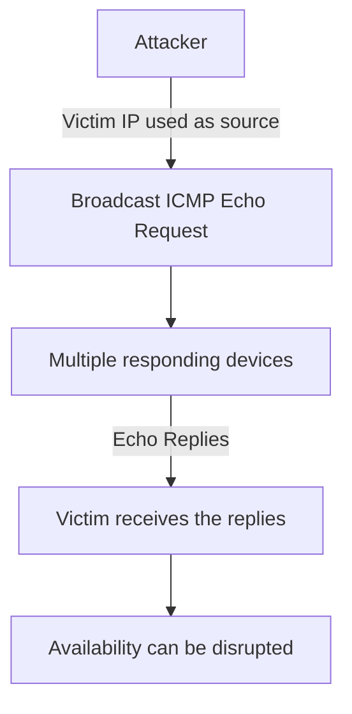

# Cybersecurity Learning Notebook

> **One notebook, organised by topic.** Simple English explanations, practical evidence and quick reference notes from my cybersecurity studies.
>
> **Learning sources:** Google Cybersecurity Professional Certificate, TryHackMe and local networking practice. The certificate is in progress. These notes describe study and guided exercises, not professional incident-response experience.

## Contents

- [01 · Network foundations](#01--network-foundations)
- [02 · IP addressing and CIDR](#02--ip-addressing-and-cidr)
- [03 · Protocols and ports](#03--protocols-and-ports)
- [04 · Wireless security](#04--wireless-security)
- [05 · Firewalls and security zones](#05--firewalls-and-security-zones)
- [06 · Proxies and VPNs](#06--proxies-and-vpns)
- [07 · TLS, HTTPS and secure file transfer](#07--tls-https-and-secure-file-transfer)
- [08 · Wireshark](#08--wireshark)
- [09 · tcpdump command reference](#09--tcpdump-command-reference)
- [10 · Recorded practical observations](#10--recorded-practical-observations)
- [11 · Network attacks and defenses](#11--network-attacks-and-defenses)
- [12 · Incident report notes](#12--incident-report-notes)
- [13 · SOC tools and working methods](#13--soc-tools-and-working-methods)
- [14 · English practice](#14--english-practice)
- [15 · Review questions](#15--review-questions)
- [16 · Evidence index and limitations](#16--evidence-index-and-limitations)
- [17 · How to maintain this notebook](#17--how-to-maintain-this-notebook)

Use the contents to jump to a topic, or browser search to find terms such as `CIDR`, `RST`, `DNS` or `SYN flood`.

---

## 01 · Network foundations

A network allows devices to exchange data using agreed rules called **protocols**.

| Term | Simple explanation |
|---|---|
| Client | Requests a service. |
| Server | Provides a service. A device can act as both a client and a server. |
| Network interface | A device's connection to a network; it can have an IP address. |
| MAC address | A link-layer address used for local frame delivery. |
| IP address | A logical address used to reach a network interface. |
| Port | Helps identify the application endpoint within a transport protocol. |
| Switch | Forwards Ethernet frames within a local network using MAC addresses. |
| Router | Forwards IP packets between networks. |
| Default gateway | The next-hop router normally used when no more specific route matches. |
| DNS | Resolves names to records, including IPv4 and IPv6 addresses. |
| ARP | Finds the MAC address for an IPv4 next hop on a local network. |

**Local destination:** the computer normally resolves the destination device's MAC address. **Remote destination:** it normally resolves the local gateway's MAC address, not the remote server's MAC address.

### TCP and UDP

| TCP | UDP |
|---|---|
| Establishes a connection. | Does not establish a TCP-style connection. |
| Provides reliable, ordered byte delivery. | Does not itself guarantee delivery or order. |
| Uses acknowledgements and retransmissions. | Applications can add their own reliability. |
| Reliability adds overhead. | Lower transport overhead; not automatically faster in every case. |



### Encapsulation

Each layer wraps data with information needed for delivery. Ethernet also adds a trailer. Decapsulation removes the wrapping at the receiving end.

| Layer | Unit and responsibility |
|---|---|
| Application | Data, such as a web request. |
| Transport | TCP segment or UDP datagram; ports and transport behavior. |
| Internet | IP packet; addressing and routing. |
| Link | Ethernet frame; local delivery. |
| Physical | Bits represented by signals. |

**OSI reference:** Physical → Data Link → Network → Transport → Session → Presentation → Application. TCP/IP groups these responsibilities differently; the models are learning tools, not identical structures.

[Back to contents](#contents)

---

## 02 · IP addressing and CIDR

### Private IPv4 ranges

| Range | CIDR |
|---|---|
| `10.0.0.0`–`10.255.255.255` | `10.0.0.0/8` |
| `172.16.0.0`–`172.31.255.255` | `172.16.0.0/12` |
| `192.168.0.0`–`192.168.255.255` | `192.168.0.0/16` |

Private addresses are not directly routed across the public internet. NAT can translate private addresses; port address translation commonly lets multiple devices share a public IPv4 address. NAT is not a replacement for access-control rules.

### What does the slash mean?

IPv4 contains **32 bits**. The prefix specifies how many belong to the network portion.

| Prefix | Network bits | Host bits | Mask | Example network |
|---|---:|---:|---|---|
| `/24` | 24 | 8 | `255.255.255.0` | `192.168.10.0/24` |
| `/16` | 16 | 16 | `255.255.0.0` | `192.168.0.0/16` |

- With `/24`, the first three octets identify the network.
- With `/16`, the first two octets identify the network.
- A `/24` contains 256 addresses, conventionally 254 usable host addresses.
- A `/16` contains 65,536 addresses, conventionally 65,534 usable host addresses.

These host counts apply to ordinary IPv4 subnets using network and broadcast addresses.

| Pair | Same subnet? | Why? |
|---|---|---|
| `192.168.10.25/24` and `192.168.10.80/24` | Yes | Both belong to `192.168.10.0/24`. |
| `192.168.10.25/24` and `192.168.20.25/24` | No | Their first three octets identify different networks. |
| `192.168.10.25/16` and `192.168.20.25/16` | Yes | Both belong to `192.168.0.0/16`. |

**Subnetting** divides an address range into smaller networks. **Network segmentation** separates network areas and controls communication. Subnetting can support segmentation, but a subnet boundary alone does not block traffic.



[Back to contents](#contents)

---

## 03 · Protocols and ports

Ports are conventions, not proof of the actual service. TCP and UDP each have port numbers from 0 to 65535.

| Service | Common port / transport | Memory aid |
|---|---|---|
| FTP control | TCP 21 | Traditional file transfer control. |
| SSH and SFTP | TCP 22 | Secure remote shell and SSH file transfer. |
| SMTP | TCP 25 | Mail transfer between servers. |
| DNS | UDP/TCP 53 | Name lookup; not UDP only. |
| DHCPv4 | UDP 67 server, 68 client | Automatic network configuration. |
| HTTP | TCP 80 | Web traffic without TLS by default. |
| POP3 | TCP 110 | Retrieve email. |
| NTP | UDP 123 | Clock synchronization. |
| IMAP | TCP 143 | Access and synchronize email. |
| SNMP | UDP 161; notifications commonly 162 | Device monitoring and management. |
| HTTPS | TCP 443; HTTP/3 uses QUIC over UDP 443 | Secure web communication. |
| SMTP submission | TCP 587 | Commonly uses STARTTLS when configured. |
| Implicit TLS mail submission | TCP 465 | TLS from connection start. |
| Implicit FTPS control | TCP 990 | Explicit FTPS usually starts on TCP 21. |
| IMAPS | TCP 993 | IMAP over implicit TLS. |
| POP3S | TCP 995 | POP3 over implicit TLS. |

ICMP and ARP do not use TCP/UDP ports. SNMP security depends on its version and configuration; SNMPv3 can provide authentication and privacy.

**Protocol groups studied:** communication, management and security. Some protocols serve more than one purpose; these are useful learning categories rather than strict boundaries.

[Back to contents](#contents)

---

## 04 · Wireless security

**IEEE 802.11** defines wireless LAN communication. **WPA** refers to a family of Wi-Fi security mechanisms. Wi-Fi communication and Wi-Fi protection are related but different concepts.

| Generation | Study takeaway |
|---|---|
| WEP | Legacy protection with serious weaknesses. |
| WPA | Transitional improvement over WEP; legacy today. |
| WPA2 | Commonly associated with AES-CCMP protection. |
| WPA3 | Adds stronger authentication protections; Personal mode uses SAE. |

**Personal:** commonly uses a shared credential for homes or small networks. **Enterprise:** typically uses 802.1X/EAP and an authentication service for individual access.

Wi-Fi link encryption protects communication between the device and access point. It does not replace end-to-end HTTPS or guarantee that the access point is trustworthy.

**Evidence boundary:** these are study notes; I have not recorded a configured wireless-security lab here.

[Back to contents](#contents)

---

## 05 · Firewalls and security zones

Firewalls inspect and allow or block traffic according to policy. Hardware, software and cloud-based describe deployment; stateful and stateless describe traffic-processing behavior.

| Type | Simple explanation |
|---|---|
| Stateless | Evaluates packets against rules without connection-state tracking. |
| Stateful | Tracks connections and evaluates traffic in that context. |
| NGFW | Can add application-aware policies and intrusion-prevention features. |
| Cloud-based firewall | Firewall capabilities hosted or delivered in a cloud environment. |
| Port filtering | Allows or blocks traffic using port-related rules. |

Stateful tracking can permit matching return traffic, but policy and configuration still determine what is allowed. Neither a firewall nor state tracking detects every threat.



This is a conceptual diagram, not a deployed network. A DMZ can use separate firewalls or multiple interfaces on one firewall. Public-facing services should not receive unrestricted access to internal systems.

- **Uncontrolled zone:** outside the organisation's control.
- **Controlled zones:** areas managed under the organisation's policies.
- **DMZ:** a separated area for selected externally reachable services.
- **Restricted zone:** stronger controls around sensitive resources.

[Back to contents](#contents)

---

## 06 · Proxies and VPNs

### Proxies

| Type | Acts on behalf of | Everyday example |
|---|---|---|
| Forward proxy | Clients | A company controls employees' outbound web access. |
| Reverse proxy | Servers | A website places a gateway in front of its application servers. |

A proxy forwards requests and can enforce policy. A proxy does not necessarily encrypt traffic, and NAT is not a requirement for a service to be a proxy.

### VPNs

A VPN can create an encrypted tunnel between endpoints over an untrusted network. Encapsulation wraps an inner packet inside another packet; encryption protects its contents. Encapsulation alone does not imply encryption.

| Connection | Example |
|---|---|
| Remote access | An employee's laptop connects to the company network. |
| Site-to-site | Two office gateways connect their networks. |

| Technology | Study takeaway |
|---|---|
| WireGuard | A VPN protocol with a compact design; supports remote-access and site-to-site arrangements. |
| IPsec | A suite for securing IP traffic; also supports both arrangements. |

A VPN does not guarantee anonymity. The VPN operator becomes part of the trust model. Only traffic routed through the tunnel is protected by that tunnel; access policies still apply after connection.

SD-WAN manages connectivity across locations. Its security depends on the product and configuration; it is not automatically identical to a VPN.

[Back to contents](#contents)

---

## 07 · TLS, HTTPS and secure file transfer

### HTTPS over TCP



This is a simplified conceptual sequence for HTTPS over TCP. HTTP/3 uses QUIC instead. TLS has its own detailed handshake, and resumption can change the exchange.

- HTTP does not itself encrypt content.
- TLS protects confidentiality and integrity and supports server authentication.
- Proper certificate validation matters.
- Packet addresses and other metadata can remain visible.
- Modern TLS decryption generally needs session secrets, such as a browser key log. A server private key alone is not generally sufficient.

### Secure file transfer

| SFTP | FTPS |
|---|---|
| SSH File Transfer Protocol. | FTP protected with TLS. |
| Commonly TCP 22. | Explicit control commonly TCP 21; implicit control TCP 990. |
| Uses SSH authentication and host-key verification. | Uses TLS certificates and FTP control/data connections. |

Reference commands, not evidence of a completed transfer:

```bash
sftp username@hostname
# Inside the SFTP session:
get filename
put filename
```

### HTTP and HTTP/2 filtering

```text
http
http2
http.request.method == "POST"
```

The POST filter is for dissected HTTP requests; it does not select every HTTP/2 request. An empty result does not prove no login occurred. Check the protocol, decryption configuration and request details.

**Lab status:** in the earlier secure-protocols challenge, the POST filter returned no packets. A verified submitted password and successful TLS decryption are not recorded here. No lab credentials are published.

[Back to contents](#contents)

---

## 08 · Wireshark

**Recorded completion:** TryHackMe **Wireshark: The Basics** is completed.

| Pane | Purpose |
|---|---|
| Packet List | One row per captured packet, with protocol and addressing details. |
| Packet Details | Expandable protocol fields for the selected packet. |
| Packet Bytes | Raw bytes shown in hex and ASCII. |

### Useful display filters

```text
frame.number == 39765
tcp.stream eq 2
arp
icmp
dns
http
http2
tcp.flags.syn == 1 && tcp.flags.ack == 0
```

These are reference filters. A display filter changes what is shown; it does not remove packets from the capture.

### Analysis habits

1. Identify the capture and question.
2. Check source, destination, protocol and time.
3. Apply a relevant filter.
4. Inspect protocol details and the conversation.
5. Record packet numbers and observations.
6. Separate observations from possible explanations.

**Expert Information** highlights findings, not confirmed attacks. **Follow TCP Stream** provides conversation context. Unreadable ASCII may be binary image data rather than encryption.

[Back to contents](#contents)

---

## 09 · tcpdump command reference

The examples below refer to the supplied TryHackMe `traffic.pcap`. Reference commands are not claims that every variation was tested.

### Read and filter

```bash
# Confirm the current directory and files.
pwd
ls

# Read the first five packets without resolving addresses or ports.
tcpdump -r traffic.pcap -nn -c 5

# Count ICMP packets using default one-line packet output.
tcpdump -r traffic.pcap -nn icmp | wc -l

# Inspect ARP and include Ethernet addresses.
tcpdump -r traffic.pcap -nn -e arp

# Inspect one DNS packet in detail.
tcpdump -r traffic.pcap -nn -vv -c 1 'udp port 53'

# Only the RST flag; excludes RST + ACK.
tcpdump -r traffic.pcap -nn 'tcp[tcpflags] == tcp-rst' | wc -l

# SYN present, even when another flag is also present.
tcpdump -r traffic.pcap -nn 'tcp[tcpflags] & tcp-syn != 0'

# Only SYN.
tcpdump -r traffic.pcap -nn 'tcp[tcpflags] == tcp-syn'

# SYN or ACK present.
tcpdump -r traffic.pcap -nn 'tcp[tcpflags] & (tcp-syn|tcp-ack) != 0'

# Packet length at least 1000 bytes / at most 100 bytes.
tcpdump -r traffic.pcap -nn 'greater 1000'
tcpdump -r traffic.pcap -nn 'less 100'
```

### Options

| Option | Meaning |
|---|---|
| `-r FILE` | Read saved packets. |
| `-w FILE` | Write captured packets to a file. Not a command by itself. |
| `-i INTERFACE` | Select an interface for live capture. |
| `-nn` | Do not resolve addresses or service port names. |
| `-c NUMBER` | Limit the number of matching packets read or captured. |
| `-e` | Include link-layer header details. |
| `-q` | Brief output. |
| `-v` / `-vv` | More protocol details. |
| `-A` | ASCII view, excluding the link header. |
| `-xx` | Hex view including the link header. |
| `-X` | Hex and ASCII, excluding the link header. |

`-A` and `-X` do not decrypt encrypted traffic. Counting output lines is useful with default one-line output, not multiline hex or verbose dumps.

### Mistakes I encountered

| Symptom | What I learned |
|---|---|
| `-w: command not found` | Options need the program name, such as `tcpdump`. |
| `traffic.pcap: No such file or directory` | Check the machine, directory and filename. The lab machine held the supplied file. |
| `Operation not permitted` | Without `-r`, tcpdump may attempt live capture, which requires capture privileges. |
| Empty filter output | Check the capture and filter assumptions before concluding that traffic is absent. |

### macOS networking reference

```bash
ipconfig getifaddr en0
route -n get default
scutil --dns
arp -a
ping -c 4 google.com
traceroute google.com
```

`en0` is an example interface; verify which interface is active. A failed ping can reflect ICMP filtering. Missing traceroute hop replies do not necessarily mean the destination is unreachable.

[Back to contents](#contents)

---

## 10 · Recorded practical observations

### Local macOS DNS capture

```bash
sudo tcpdump -i en0 -nn -c 10 'port 53'
```

| Observation | Recorded value |
|---|---|
| Local interface and address | `en0`, `192.168.1.115` |
| Default gateway and observed DNS destination | `192.168.1.1` |
| Packets captured | 10 |
| Packets received by filter | 526, as reported by the capture tool |
| Packets dropped by kernel | 0 |
| DNS activity | Brave and Apple-related names; A, CNAME and Type 65 records appeared. |

The two packet counters are different capture statistics and should not be treated as the same measurement. This short sample does not prove absence of all packet loss, attacks or network problems.

### TryHackMe tcpdump capture

| Evidence | Observation |
|---|---|
| Input | Provided `traffic.pcap` on the lab machine. |
| ICMP filter and count | 26 ICMP packets. |
| ARP request | `192.168.124.148` asked for the MAC of `192.168.124.137`. |
| ARP reply | `192.168.124.137` was associated with `52:54:00:23:60:2b`. |
| DNS query | `192.168.124.137:33672` queried `192.168.124.1:53` for an A record for `mirrors.rockylinux.org`. |
| RST-only count | The command was discussed; a verified count is not recorded. |

The final room completion state for tcpdump is not confirmed in these notes. A screenshot showed 88% with Conclusion remaining; subsequent practice is recorded without inventing completion.

### TryHackMe Wireshark capture

| Evidence | Observation |
|---|---|
| Input | Provided `Exercise.pcapng`. |
| Packet 9100 | Malformed HTTP and illegal characters in a header name were reported. |
| TCP stream 2 | Unreadable characters and a `JFIF` marker were observed. |
| Packet 12 | A comment directed further packet inspection. |
| Packet 39765 | HTTP `200 OK` and JPEG details appeared. |
| Reassembled body | De-chunked JPEG entity body: 3324 bytes. |

The JPEG finding does not establish the cause of the malformed HTTP warning. Image export and a verified MD5 result are not recorded.

[Back to contents](#contents)

---

## 11 · Network attacks and defenses

| Concept | Meaning | Main concern / defense |
|---|---|---|
| Packet sniffing | Capture and inspect traffic. Can be authorised troubleshooting. | Protect sensitive content with encryption and control capture access. |
| IP spoofing | Forge the source IP address. | Source validation; do not trust an IP address alone. |
| MAC spoofing | Change or impersonate a link-layer address. | Separate from IP spoofing. |
| On-path attack | Intercept communication, potentially reading or changing it. | TLS with proper certificate validation. |
| Replay | Reuse a previously captured message. | Nonces, sequence checks, timestamps and suitable authentication protocols. |
| Backdoor | A mechanism that bypasses normal access controls. | Review access, integrity and suspicious persistence mechanisms. |
| Persistence | Maintain access across time or restarts. | Monitor unexpected accounts, services and startup changes. |
| DoS | Disrupt legitimate access to a service. | Availability monitoring, filtering and capacity protections. |
| DDoS | Denial of service from distributed sources. | Upstream DDoS protection and appropriate rate controls. |
| SYN flood | Repeated connection-start requests can exhaust connection resources. | SYN cookies, appropriate backlog management and network filtering. |
| Smurf | Spoofed ICMP requests to broadcast networks cause replies to flood a victim. | Disable directed broadcast forwarding and broadcast echo replies; source validation. |

### Promiscuous mode

Promiscuous mode accepts frames reaching the interface even when they are not addressed to it. It does not make a switch deliver every other device's unicast traffic. An authorised mirror port or suitable capture location may be needed.

### Smurf reflection and amplification



**Reflection:** replies go to the spoofed source. **Amplification:** one request can produce multiple replies.

### Confidentiality, integrity and availability

| Example | Property affected |
|---|---|
| Reading a private unencrypted message | Confidentiality |
| Changing payment details in transit | Integrity |
| Flooding a service so customers cannot connect | Availability |

An attack can affect more than one property. HTTPS protects content but does not by itself stop DoS. A SYN or RST packet alone is not proof of an attack. DoS does not require spoofing, prior sniffing or a complete server crash.

### Additional attack concepts

| Concept | What I learned | Everyday example |
|---|---|---|
| Passive packet sniffing | Observing available traffic without changing it. The capture location determines what is visible. | Someone reads an unencrypted message passing through a network they can monitor. |
| Active packet sniffing | Manipulating network traffic or its delivery to make interception possible. | An attacker redirects a device's traffic through their own machine. |
| Botnet | A group of compromised devices controlled by an attacker. A botnet can be used for DDoS and other activities. | Many infected home cameras send unwanted traffic to an online shop at the same time. |
| ICMP flood | A large volume of ICMP traffic can consume network or processing capacity. | A company's connection becomes overloaded, preventing customers from reaching its website. |
| Ping of death | A historical attack involving malformed, oversized packets after reassembly. It differs from sending many normal-sized ping requests. | A vulnerable device fails while trying to process an invalid packet. |

### An important distinction

Packet sniffing is an observation technique and can also be used
for legitimate troubleshooting. IP spoofing changes a packet's
source IP address. Neither technique automatically gives an
attacker access to a system.

These are study examples, not attacks I performed or observed
in a new capture.

[Back to contents](#contents)

---

## 12 · Incident report notes

### Case A: DNS lookup failure

**Source:** Google Cybersecurity supplied tcpdump log and scenario, not a capture I generated.

| Field | Evidence / interpretation |
|---|---|
| Website | `yummyrecipesforme.com` |
| Client | `192.51.100.15` |
| DNS server | `203.0.113.2` |
| Request | DNS query using UDP destination port 53. |
| First query | `13:24:32.192571`; this is not the known first customer-report time. |
| Repetition | Queries at approximately 13:24:32, 13:26:32 and 13:28:32. |
| Response | ICMP Destination Unreachable: `udp port 53 unreachable`. |
| Impact | No successful DNS answer to provide the website address in the supplied exchange. |
| Possible causes | DNS not listening/running or traffic rejected by policy. |
| Status | Escalated in the scenario; recovery not confirmed. |

The server did send an ICMP error; saying it sent no response at all would be inaccurate. This is not an ICMP Echo Reply. The error alone does not prove an attack.

`35084` identifies a DNS transaction, not a port. `A?` indicates an IPv4-address query, not an error. The `+` on the query indicates recursion desired; it is not itself evidence of a failure.

**Operational checks:** verify the DNS process, listening socket and firewall rules; restore the failed component if identified; repeat name resolution and website access tests. These are proposed checks, not actions I performed on a real server.

### Case B: Suspected SYN flood

**Source:** Google Cybersecurity supplied TCP/HTTP spreadsheet and reading guide. I reviewed the table, not a live capture or original PCAP in Wireshark.

| Evidence | Observation |
|---|---|
| Suspicious source | `203.0.113.0` |
| Destination | `192.0.2.1`, TCP port 443 |
| Entries 55, 56, 58 | A legitimate handshake completed. |
| Entries 60, 62 | GET `/sales.html` and HTTP `200 OK`. |
| Entry 73 | TCP `RST, ACK` to a legitimate client. |
| Entry 77 | `504 Gateway Time-out` in the log text. |
| Entry 125 onward | Repeated incoming SYN requests without further server replies in the supplied remainder. |

**Interpretation:** consistent with the SYN flood DoS scenario. One suspicious source address is visible; the excerpt does not demonstrate distributed sources. Repeated SYNs can exhaust connection-handling resources, especially with incomplete handshakes.

**Boundaries:** server resource usage, actual backlog exhaustion, server crash, attacker identity and recovery were not independently confirmed. The spreadsheet is a simplified teaching log; its elapsed-time column is not clock time. Labels in the spreadsheet are supporting context rather than a substitute for examining packet fields.

### A useful report structure

1. Summary and impact.
2. Source, evidence and timeline.
3. Analysis and uncertainty.
4. Actions taken versus proposed checks.
5. Current status and responsible team, if known.

The course's Part 1 / Part 2 headings are activity-specific, not a universal company standard. A ticket may be enough for a small event. Operational response recommendations may belong in a report; personal study tasks remain in SelfCamp.

[Back to contents](#contents)

---

## 13 · SOC tools and working methods

| Tool or system | Role |
|---|---|
| Wireshark / tcpdump | Inspect packets and conversations. |
| SIEM, such as Splunk Enterprise Security, Microsoft Sentinel or Elastic Security | Search collected logs, correlate events and investigate alerts. |
| Case management / ticketing | Record ownership, evidence, findings, actions and status. |

A SIEM helps gather and organise evidence; it does not automatically turn every alert into a proven incident. Related server and firewall logs must actually be collected to investigate them in the SIEM.

**Skills from QA:** reproduce the symptom, check inputs, distinguish expected from observed behavior, document clear evidence and avoid unsupported conclusions.

### Open-source contribution

I contributed a small documentation improvement to the ZAP website contributor guide: pointing contributors to `.nvmrc` for the Node.js version before installing dependencies.

[Merged ZAP documentation pull request #4069](https://github.com/zaproxy/zaproxy-website/pull/4069)

This is a documentation contribution, not a discovered security vulnerability or production SOC experience.

[Back to contents](#contents)

---

## 14 · English practice

Use these as speaking prompts alongside the relevant topic in SelfCamp. Describe the observation first, then the interpretation, then the limitation.

| Topic | Say it simply | Speaking prompt |
|---|---|---|
| CIDR | “The prefix separates the network and host portions.” | Explain why two `/24` addresses are local or remote. |
| DNS | “The computer asks for the domain's IP address.” | Identify the query, response and service port. |
| ARP | “The device asks which MAC address belongs to this local IP.” | Explain who asked and who replied. |
| TCP | “The client sends SYN, the server sends SYN-ACK, and the client sends ACK.” | Explain a normal connection without notes. |
| VPN | “The tunnel protects traffic between its endpoints.” | Compare a remote employee with two offices. |
| Filtering | “This filter selects packets with only RST set.” | Explain each part of a command. |
| Investigation | “The evidence suggests a problem, but the cause is not confirmed.” | Separate a finding from a hypothesis. |
| Availability | “Legitimate users cannot reliably access the service.” | Explain the impact of the SYN flood scenario. |

Useful words: **source, destination, query, response, capture, filter, evidence, suspected, confirmed, timeout, availability, recovery**.

## 15 · Review questions

<details>
<summary>What is the difference between an IP address and a port?</summary>

An IP address identifies a network interface. A transport port helps identify an application endpoint on that interface.

</details>

<details>
<summary>What do /24 and /16 mean?</summary>

They reserve 24 and 16 bits for the network portion, leaving 8 and 16 bits for the host portion.

</details>

<details>
<summary>Does subnetting alone isolate departments securely?</summary>

No. Routing and access-control policies determine which traffic can pass between subnets.

</details>

<details>
<summary>Does a VPN guarantee anonymity?</summary>

No. Protection depends on routing, endpoints, protocols, configuration and the provider's trustworthiness.

</details>

<details>
<summary>Does unreadable ASCII prove encryption?</summary>

No. Binary images, compression and other formats can also look unreadable.

</details>

<details>
<summary>Does promiscuous mode show the whole switched network?</summary>

No. The interface must receive the traffic in the first place.

</details>

<details>
<summary>What is the difference between only SYN and SYN present?</summary>

`== tcp-syn` requires the flag field to match SYN only. `& tcp-syn != 0` checks whether SYN is present, even alongside ACK.

</details>

<details>
<summary>What did the DNS error prove?</summary>

The supplied queries received ICMP port-unreachable errors. The cause and whether an attack occurred were not confirmed by those packets alone.

</details>

<details>
<summary>Why is the SYN flood scenario about availability?</summary>

Legitimate users experienced connection failures and timeouts, preventing reliable service access.

</details>

<details>
<summary>Does HTTPS stop DDoS?</summary>

No. Encryption protects communication contents; availability needs suitable traffic and capacity defenses.

</details>

[Back to contents](#contents)

---

## 16 · Evidence index and limitations

| Item | Evidence category | Recorded status |
|---|---|---|
| macOS DNS capture | Local command output shared during study | 10 packets captured; no attack conclusion. |
| Wireshark Basics | Guided lab and completion screenshot | Room completed; selected observations recorded. |
| tcpdump Basics | Guided lab output | 26 ICMP packets and selected ARP/DNS evidence; final completion and RST count not recorded. |
| DNS failure report | Course-provided scenario | AI-assisted study report; recovery not confirmed. |
| SYN flood report | Course-provided spreadsheet | AI-assisted study report; resource exhaustion not directly measured. |
| ZAP documentation | Public merged contribution | Small documentation contribution accepted. |
| Certificate | Ongoing training | Not represented as completed. |

Related detailed portfolio files:

- [IP addressing](../network/ip-basics.md)
- [Wireless security](../network/wireless-security.md)
- [Firewalls and security zones](../network/security-zones.md)
- [Network traffic report](../network/network-traffic-report.md)

This notebook consolidates the conversation's study notes, the retrieved networking-foundations note and traffic report, and the supplied lab evidence. It is not a complete export of SelfCamp's private notes. No missing progress records have been recreated as completed work.

I used AI assistance for explanations, command guidance, editing and organisation. Reference commands and conceptual diagrams do not imply deployment or independent execution. No lab passwords, flags or raw proprietary captures are included. The example addresses are lab values; they are not targets for testing.

## 17 · How to maintain this notebook

1. Find the matching topic using the contents or search.
2. Improve the existing explanation instead of repeating it under a new day heading.
3. Add new practical results under **Recorded practical observations** or the relevant case.
4. Record the source, command/filter, observed output, interpretation and limitation.
5. Update an unconfirmed status only when supporting evidence is available.
6. Keep study scheduling and personal revision tasks in SelfCamp.

For a new observation, reuse this small block:

```text
Source / environment:
Question:
Command or filter:
Observed result:
Interpretation:
Limitations:
```

**Visual format:** Mermaid diagrams, tables and expandable review cards render in GitHub Markdown. They are static; GitHub does not run custom JavaScript or CSS animations inside Markdown notes.

[Back to contents](#contents)
